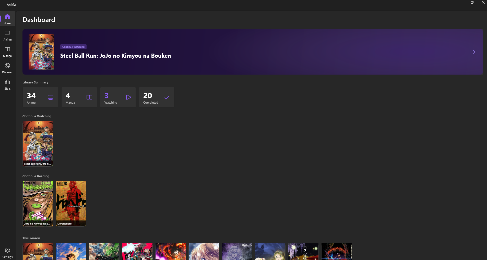
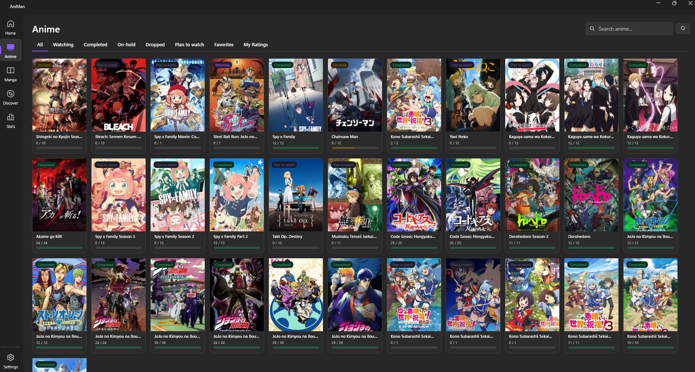
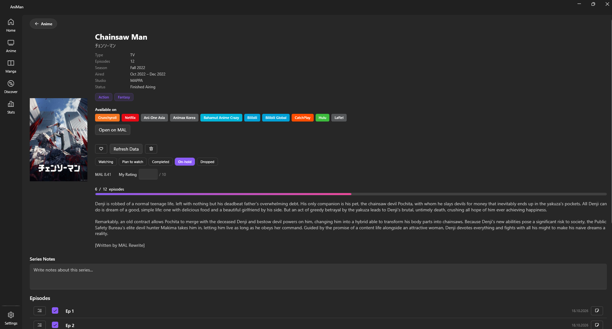
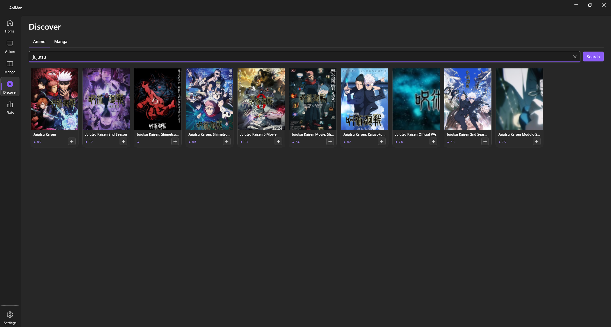

# AniMan

[](https://github.com/mirmehmet/animan/actions/workflows/ci.yml)
[](LICENSE)

A modern WPF desktop app for tracking anime and manga, powered by the [Tenrai](https://tenrai.org/) (MyAnimeList) API with [AniList](https://anilist.co/) as an automatic fallback.

---

## Screenshots

| Dashboard | Library |
| :---: | :---: |
|  |  |
| **Media Details & Streaming Links** | **Add & Search** |
|  |  |

---

## Features

- Search the MyAnimeList catalogue and add anime & manga to your library, with a separate search per tab and paged popular lists
- Keeps working when the primary API is down — requests fall back to AniList and return on their own
- Personal library with status tracking (Watching, Completed, On-hold, Dropped, Plan to watch), favorites and your own ratings
- Library filters: format, year range, genres and themes (match *all* or *any*), demographic, release status, source, age rating and your rating — plus a sort that works on every tab
- Adjustable cover size, from a compact cover-only grid to detailed cards, in a grid that spans the full width
- Episode and chapter progress tracking
- Detail pages with English titles, themes, demographic, episode length, source, age rating and manga authors
- Streaming platform availability with direct links to providers (Crunchyroll, Netflix, Disney+, Prime Video, etc.)
- Cover art downloaded and cached locally
- Stats dashboard for anime and manga: watch time, activity calendar, score distribution, top genres, your taste vs MAL and release years — click a status, genre or year to open your library filtered
- Export & import your library as a portable JSON backup (Merge or Overwrite), with a progress window and summary; backups from older versions still import
- Light / Dark / System theme with violet accent
- Turkish and English localization

---

## Built With

- **WPF + WPF UI 4** — UI framework and Fluent controls
- **CommunityToolkit.Mvvm** — MVVM source generators
- **Tenrai + AniList** — MyAnimeList metadata over REST, with AniList's GraphQL API standing in when the primary cannot answer
- **EF Core 9 + SQLite** — Two separate databases: `catalog.db` (disposable API cache) and `library.db` (user data)
- **Polly** — Retry and resilience for API calls
- **Serilog** — Structured daily rolling logs
- **xUnit** — Unit and integration tests

---

## Data

All user data lives under `%APPDATA%\AniMan\`:

```
AniMan/
├── catalog.db    — API metadata cache (can be deleted safely)
├── library.db    — your library, progress, notes, ratings and settings
├── covers/       — downloaded cover images
└── logs/         — daily log files
```

---

## Download

Go to **[Releases](https://github.com/mirmehmet/animan/releases)** and grab the latest `AniMan-vX.Y.Z.exe` (or `AniMan.exe`). No installation or .NET runtime required — just run it.

---

## Build & Run

Requires the [.NET 10 SDK](https://dotnet.microsoft.com/download). Windows only (WPF).

```bash
git clone https://github.com/mirmehmet/animan.git
cd animan
dotnet restore AniMan.slnx
dotnet build AniMan.slnx
dotnet run --project src/AniMan/AniMan.csproj
```

To produce a single self-contained executable:

```bash
dotnet publish src/AniMan/AniMan.csproj -c Release -r win-x64 -o publish
```

Output: `publish/AniMan.exe` — no .NET installation needed on the target machine.

To run tests:

```bash
dotnet test AniMan.slnx
```

---

*Made with curiosity by [Mir](https://github.com/mirmehmet)*
